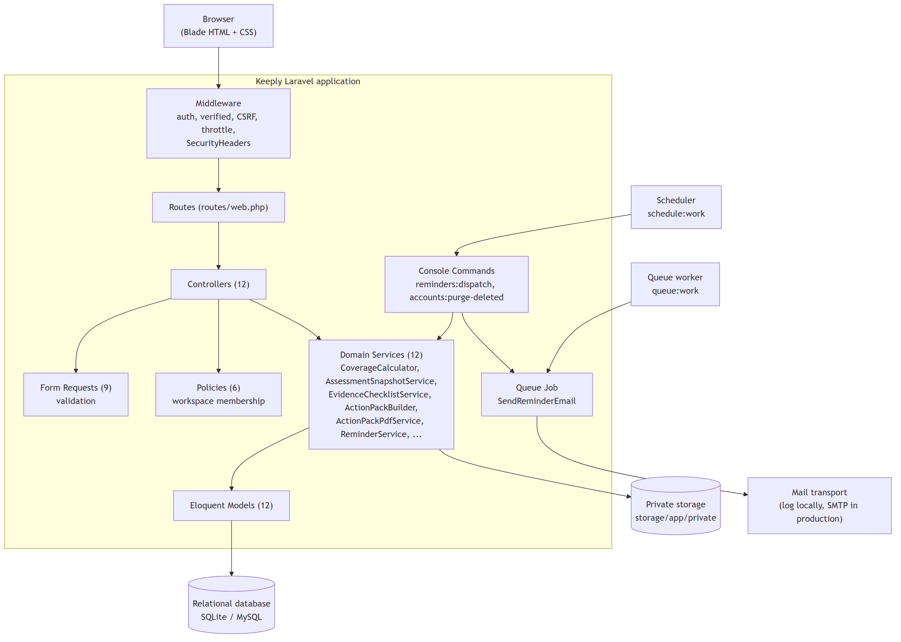
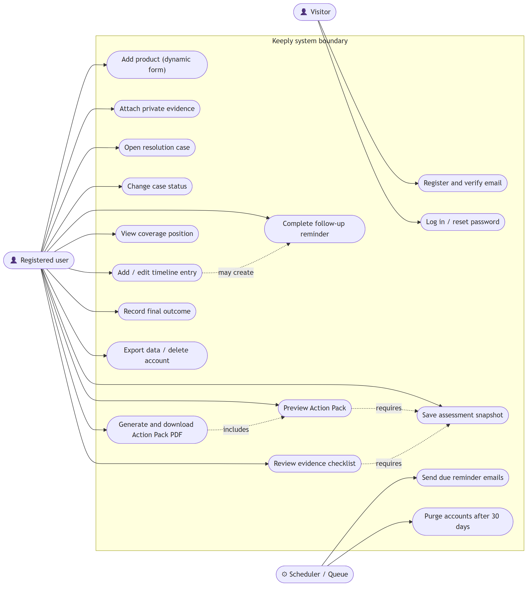
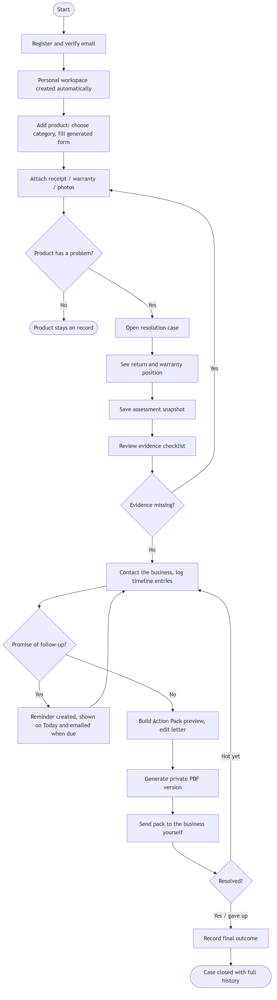
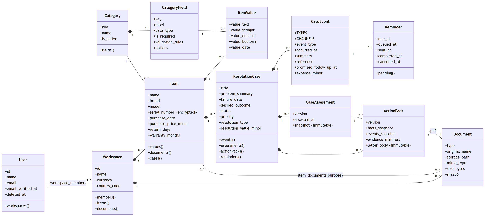
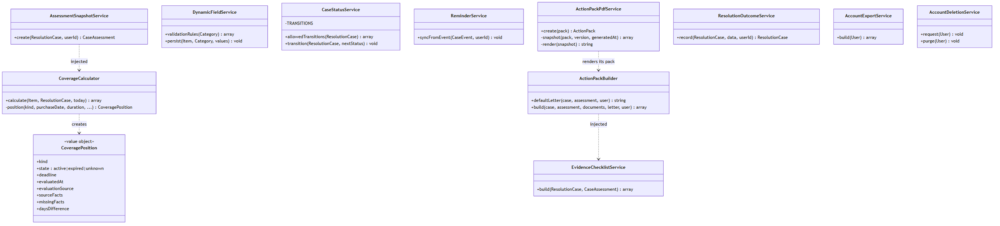
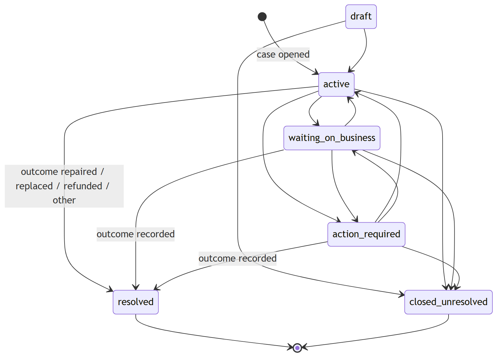
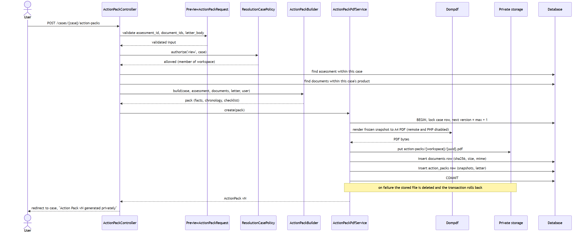
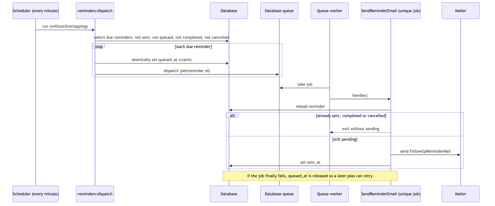
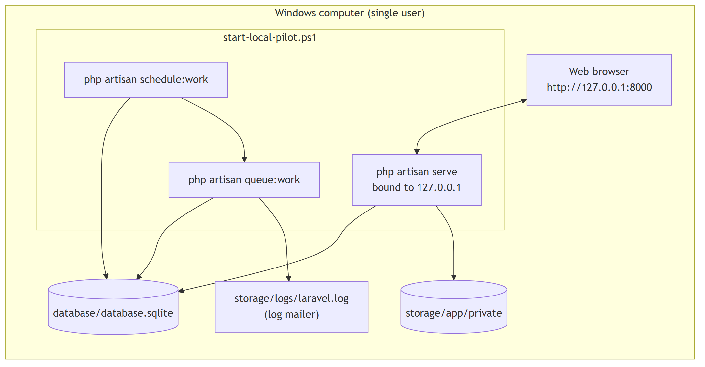
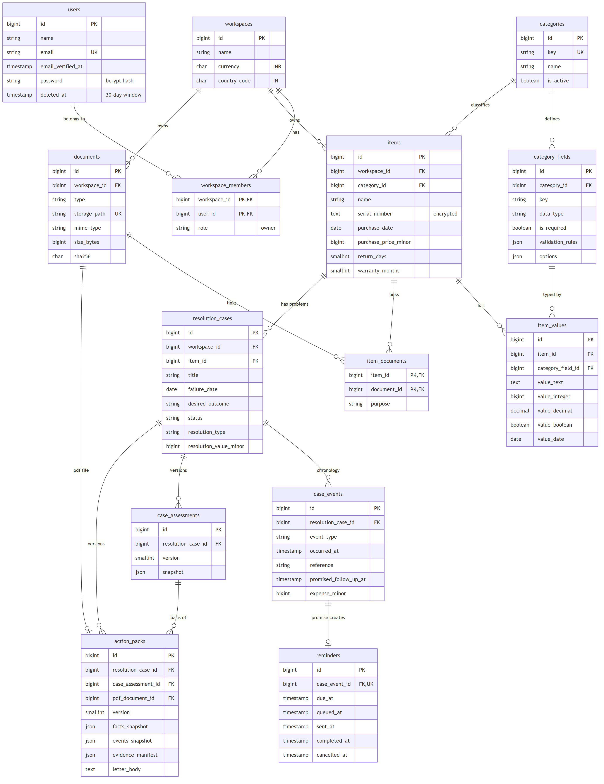

# Keeply

**An ownership-resolution app for product returns, repairs and warranty claims.**


When something you bought breaks, Keeply tells you where you stand and helps you act on it. It records the product and its receipts, works out whether the return or warranty period is still active, keeps a dated record of every call and promise, reminds you when a follow-up is due, and produces a factual Action Pack PDF you can send to the seller.

---

## Architecture at a glance

<picture>
  <source media="(prefers-color-scheme: dark)" srcset="docs/archify/architecture-dark.svg">
  
</picture>

One Laravel application (a modular monolith) runs as three processes:

| Process | Job |
|---|---|
| **Web app** | Serves every page, checks workspace permissions, stores records and private files |
| **Scheduler** | Every minute, finds reminders that are due and puts an email job on the queue |
| **Queue worker** | Takes jobs off the database queue and sends the email, recording when it was sent |

> The diagram above is generated with [archify](https://skills.sh/tt-a1i/archify). For the interactive version (theme switch, hover details, links from each box to the source file), download [`docs/archify/architecture.html`](docs/archify/architecture.html) and open it in a browser.

---

## Features

| Area | What it does |
|---|---|
| **Accounts and workspaces** | Registration, email verification, login with rate limiting, password reset. Each user gets a private workspace; other users get `403 Forbidden`. |
| **Products** | Category-driven forms (Laptop, Other product) built from database field definitions. Serial numbers are stored encrypted. |
| **Private documents** | Receipts, warranty cards, manuals and photos (PDF, JPG, PNG, WebP, up to 10 MB). Files live outside the public folder, are checked by their real contents, and carry a SHA-256 hash. |
| **Resolution cases** | Open a return, repair or warranty case with a desired outcome and priority. Status changes only through allowed transitions. |
| **Timeline** | Contacts, replies, visits, repairs, expenses, promises and escalations, always shown in date order, even after edits. |
| **Reminders** | A promised follow-up becomes a reminder on the Today page and a queued email, with duplicate-send protection. |
| **Coverage calculator** | Shows return and warranty as **Active**, **Expired** or **Unknown**, with the exact deadline and the reason. Missing facts give Unknown, never a false Expired. |
| **Assessment snapshots** | Saves a numbered, read-only copy of the calculation, so later product edits cannot rewrite it. |
| **Evidence checklist** | Marks each piece of evidence Present, Missing, Optional or Not applicable, and says which fact decided it. |
| **Action Pack** | Editable letter, chronology and evidence list, previewed in the browser and then generated as a private, versioned PDF. |
| **Outcome** | Close a case as repaired, replaced, refunded, rejected, abandoned or other, keeping its full history. |
| **Your data** | JSON export of everything you stored. Account deletion needs your password and a typed phrase, then gives a 30-day recovery window before a permanent purge. |

---

## How a case flows

```text
Add product ──► Attach receipt ──► Problem appears ──► Open case
                                                          │
          ┌───────────────────────────────────────────────┘
          ▼
   Coverage position ──► Save assessment ──► Evidence checklist
          │                                         │
          ▼                                         ▼
   Log contacts and promises ──► Reminders ──► Action Pack PDF ──► Record outcome
```

---

## Design diagrams

All diagrams are rendered from the Mermaid sources in [`docs/diagrams`](docs/diagrams). Click a section to open it.

<details>
<summary><b>System architecture</b></summary>


</details>

<details>
<summary><b>Use case diagram</b></summary>


</details>

<details>
<summary><b>Activity diagram: the core user journey</b></summary>


</details>

<details>
<summary><b>Class diagram: domain model</b></summary>


</details>

<details>
<summary><b>Class diagram: service layer</b></summary>


</details>

<details>
<summary><b>State diagram: resolution case lifecycle</b></summary>


</details>

<details>
<summary><b>Sequence diagram: generating an Action Pack PDF</b></summary>


</details>

<details>
<summary><b>Sequence diagram: queued reminder email</b></summary>


</details>

<details>
<summary><b>Deployment diagram: local Windows pilot</b></summary>


</details>

<details>
<summary><b>Entity-relationship diagram</b></summary>


</details>

---

## Tech stack

| Layer | Technology |
|---|---|
| Language | PHP 8.3 |
| Framework | Laravel 12 (Eloquent, policies, queues, scheduler, mail, signed URLs) |
| PDF | dompdf 3.1.6, with remote loading and PHP execution turned off |
| Database | SQLite locally, MySQL 8 as the production target |
| Views | Blade templates and hand-written CSS ("Personal Cabinet" design), no CSS or JS framework |
| Testing | PHPUnit through `php artisan test`, Laravel Pint for formatting |

Measured size: 3,228 lines of PHP in `app/`, 1,993 lines of Blade, 14 migrations, 22 test files.

---

## Run it locally (Windows)

**You need:** PHP 8.3 and Composer 2. The XAMPP PHP 8.1 runtime is too old for Laravel 12.

First-time setup:

```powershell
git clone https://github.com/PrincePatel-027/Keeply-PHP-Case-Study.git
cd Keeply-PHP-Case-Study
composer install
copy .env.example .env
php artisan key:generate
php artisan migrate --seed
```

`--seed` loads the Laptop and Other product categories.

Start the web server, queue worker and scheduler together:

```powershell
.\scripts\start-local-pilot.ps1
```

Open [http://127.0.0.1:8000](http://127.0.0.1:8000). Use `-Port 8010` for another port. Stop everything with:

```powershell
.\scripts\stop-local-pilot.ps1
```

Locally, emails are written to `storage/logs/laravel.log` instead of being sent. To run the three processes by hand, the troubleshooting table and backup steps, see [`docs/LOCAL_WINDOWS_PILOT.md`](docs/LOCAL_WINDOWS_PILOT.md).

Run the tests:

```powershell
php artisan test
```

---

## Using Keeply

1. **Register** and verify your email. In local development the verification page has a **Verify and continue** button.
2. Go to **Products → Add a product**, pick a category and fill in the purchase details.
3. On the product page, attach the receipt and any warranty document under **Private documents**.
4. When something goes wrong, choose **Open a case** and describe the problem.
5. Check the **Recorded coverage position**, then **Save assessment snapshot**.
6. Log each call, visit or promise with **Add timeline entry**. Promised follow-ups appear on **Today**.
7. Use **Build Action Pack preview**, edit the letter, then **Generate private PDF**.
8. When it's settled, record the outcome to close the case.
9. Under **Account** you can export your data or delete your account.

---

## Security and privacy

- Every record belongs to a workspace, and every route checks membership.
- Uploaded files are stored privately and only downloadable by workspace members.
- File types are checked from the file contents, so a renamed `.php` file is rejected.
- Strict Content Security Policy, anti-clickjacking and no-cache headers on private pages.
- Assessments and Action Packs cannot be edited or deleted once created.
- `.env`, the database, uploaded files and generated PDFs are not in this repository.

Full review: [`docs/PILOT_READINESS_REVIEW.md`](docs/PILOT_READINESS_REVIEW.md). Retention rules: [`docs/DATA_RETENTION.md`](docs/DATA_RETENTION.md).

---

## Project structure

```text
app/
  Http/Controllers/   request handling and authorisation
  Http/Requests/      form validation
  Models/             Eloquent models
  Policies/           workspace access rules
  Services/           coverage, snapshots, checklist, Action Pack, export, deletion
  Jobs/  Mail/        queued reminder email
database/migrations/  14 migrations
resources/views/      Blade templates
public/css/keeply.css hand-written stylesheet
scripts/              local pilot start/stop scripts
tests/                22 feature and unit test files
docs/                 report, diagrams, pilot and security documents
```

---

## Future scope

- Hosting on a Laravel-capable server with managed MySQL, private cloud storage, HTTPS and real email
- Shared household workspaces with invitations, roles and ownership transfer
- More categories (phones, appliances, furniture, vehicles) and an admin screen for them
- Optional receipt OCR to pre-fill purchase details, always confirmed by the user
- SMS or WhatsApp reminders and calendar export
- Bundling the original evidence files into the Action Pack
- An installable mobile version with camera capture

## Documentation

The full project report is [`docs/REPORT.md`](docs/REPORT.md), also available as [`docs/Keeply-Submission-Report.docx`](docs/Keeply-Submission-Report.docx).

---

Built by **Prince Nareshkumar Patel** as a PHP case study.
