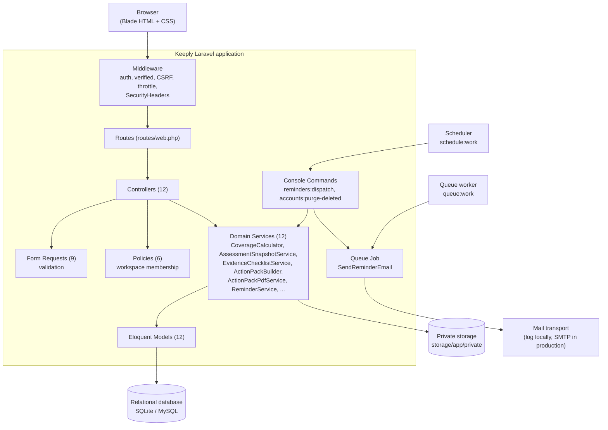
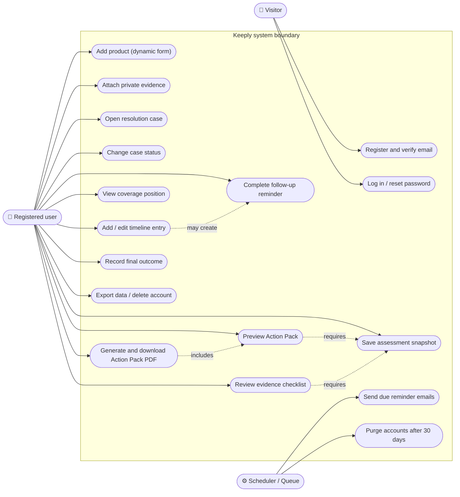
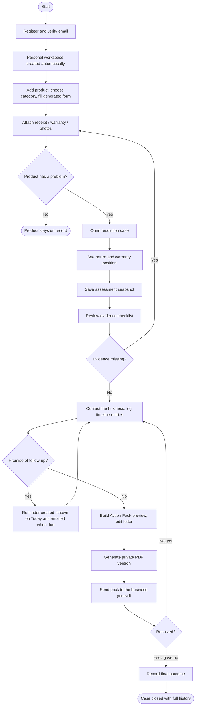
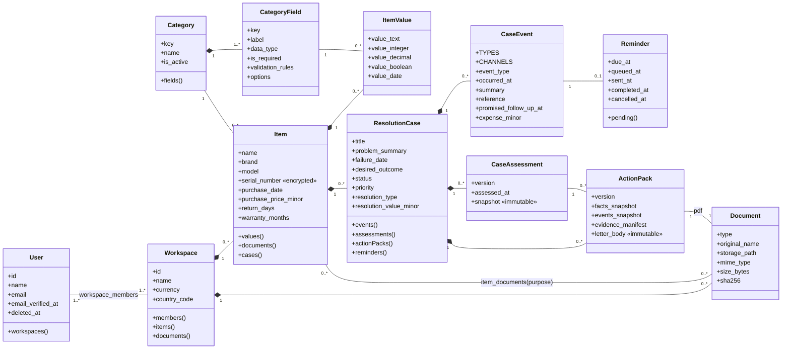
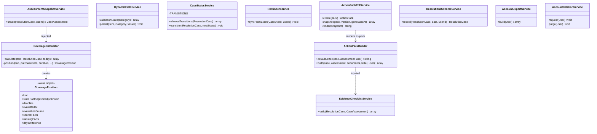
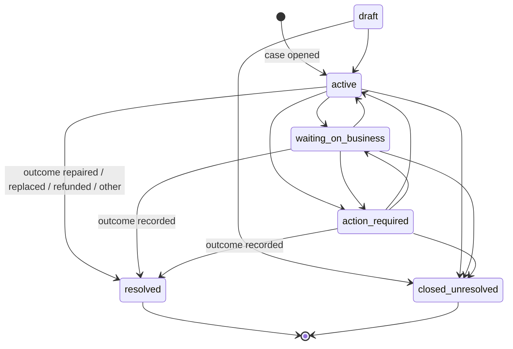
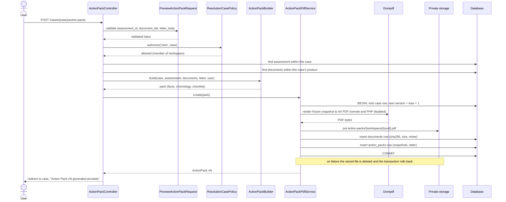
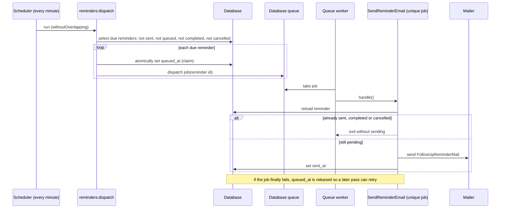
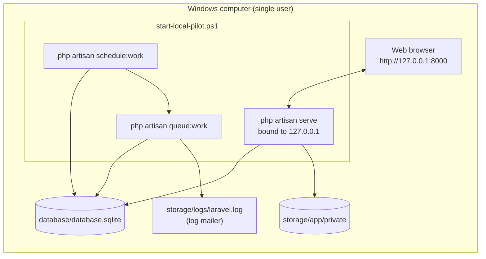
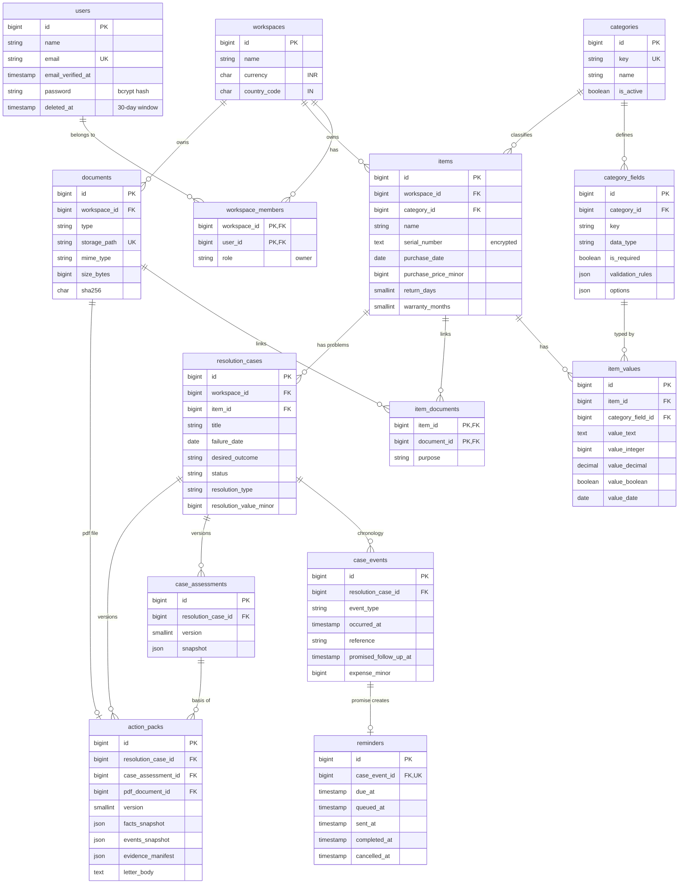

# Keeply
## An ownership-resolution platform for product returns, repairs and warranty claims

**Project report and submission document: a Laravel 12 / PHP 8.3 web application**

---

| | |
|---|---|
| **Submitted by** | Prince Patel |
| **Course** | *(to be completed)* |
| **Institution** | *(to be completed)* |
| **Guide** | *(to be completed)* |
| **Date** | *(to be completed)* |
| **Platform** | PHP 8.3.33, Laravel Framework 12.69.3, SQLite (local pilot) / MySQL 8 (production target), Windows 11 |
| **Runtime dependency added** | `dompdf/dompdf` 3.1.6 (exact pin) for PDF generation |
| **Test result** | 75 automated tests, 399 assertions, all passing (full suite, 15 October 2026) |

---

## 1. Abstract

People rarely have trouble *keeping* a receipt. The trouble starts when a product fails:
working out whether it is still under return or warranty, finding the right evidence,
remembering who promised what on which call, and putting together a clear, factual request
the seller or service centre can't easily brush off. Most of that work ends up scattered
across email, WhatsApp, photo galleries and memory.

Keeply is a web application that takes one product problem through to a recorded outcome. A
user records a product with category-specific details, attaches private evidence, and opens a
**resolution case** when something goes wrong. Keeply then:

- works out the return and warranty position from the recorded facts and shows its reasoning;
- keeps a dated chronology of contacts, repairs, expenses and promises;
- turns promised follow-ups into reminders on the dashboard and by email;
- lists which evidence is present, missing or optional, and why;
- produces an immutable, versioned **Warranty Action Pack** PDF containing the facts, the
  chronology, an evidence integrity manifest and an editable request letter;
- records the final outcome while keeping the full history.

The application is a modular Laravel monolith with 13 domain tables, 12 domain services,
6 authorisation policies and 75 automated tests. Security and privacy are part of the design
rather than add-ons. Every record is scoped to a workspace and checked by a policy. Uploaded
files are checked by their actual bytes and stored outside the public web root. Serial numbers
are encrypted at rest. Assessments and Action Packs can't be changed after they are created.
Account deletion follows a documented 30-day retention window.

## 2. Introduction

### 2.1 Background

Consumer products like laptops, phones, appliances and furniture come with return windows and
manufacturer warranties measured from the purchase date. Whether a claim succeeds usually comes
down to a few facts: when the product was bought, when the fault appeared, what proof exists,
and what has already been said to the business. These facts are usually known to the
consumer, but they are rarely organised when they are needed.

### 2.2 Problem statement

When a product fails, the owner has to answer questions under time pressure:

1. Is the product still inside its return period or warranty, and until what date?
2. Which documents and identifiers will the business ask for, and do I have them?
3. Who did I speak to, when, under which reference number, and what did they promise?
4. How do I present all of this clearly enough to get a repair, replacement or refund?
5. What finally happened, and what did it cost me?

Existing tools mostly stop at storing receipts or reminding the user when a warranty is about
to expire (Section 4). Few of them help after the failure has happened, which is when the
user actually needs help.

### 2.3 Proposed solution

Keeply treats the **resolution case** as its main object, not the receipt. Its core loop is:

> **Record a product → discover an important action → complete it using organised evidence.**

### 2.4 Product principles

- **Factual, not legal.** Keeply organises and calculates from what the user recorded. It
  never claims eligibility or gives legal advice, and it says so on every assessment and
  Action Pack.
- **Unknown is never expired.** If a needed fact is missing, the result is `unknown` and the
  missing fact is named. It is never shown as a false "expired".
- **Explain every result.** Every coverage state and checklist row shows the fact that
  produced it.
- **History is never rewritten.** Assessments and Action Packs are frozen snapshots, so
  editing the product later cannot change what was claimed at the time.
- **Private by default.** Evidence never sits in a public directory, and every request is
  checked against workspace membership.

## 3. Objectives and Scope

### 3.1 Objectives

| # | Objective | Where it is met |
|---|---|---|
| O1 | Secure registration, verification, login and password recovery | Section 9.1 |
| O2 | Private workspaces with enforced membership-based access | Sections 9.1, 10 |
| O3 | Product records whose form is generated from database metadata | Section 9.2 |
| O4 | Private, integrity-hashed evidence uploads | Section 9.3 |
| O5 | Resolution cases with a controlled state machine | Section 9.4 |
| O6 | A chronological, editable case timeline | Section 9.5 |
| O7 | Follow-up reminders in-app and by queued email | Section 9.6 |
| O8 | Explainable return/warranty coverage calculation | Section 9.7 |
| O9 | Immutable, versioned assessment snapshots | Section 9.8 |
| O10 | A factual evidence checklist | Section 9.9 |
| O11 | Printable preview and immutable private Action Pack PDF | Section 9.10 |
| O12 | Final outcome recording that preserves history | Section 9.11 |
| O13 | Account data export and retention-safe deletion | Section 9.12 |
| O14 | Security-header, caching and accessibility baseline | Sections 10, 11 |

### 3.2 In scope (Version 1)

Authentication, personal workspace, two product categories (Laptop, Other product) with
dynamic fields, private documents, resolution cases, timeline, reminders, coverage
assessment, evidence checklist, Action Pack preview and PDF, outcomes, export/deletion and a
local Windows pilot runtime.

### 3.3 Explicitly out of scope

OCR of receipts, AI suggestions, retailer or manufacturer integrations, sending claims to
businesses on the user's behalf, shared household workspaces with invitations, native mobile
apps, payments, and a public production deployment. These are covered in Section 17.

## 4. Existing System Study

Desk research (Phase 0 validation, October 2026) looked at current consumer tools:

| Product | What it does well | What it does not do |
|---|---|---|
| HousePulse (iOS) | Home maintenance schedules and reminders | No failure-to-resolution workflow, no claim dossier |
| WarrantyHub / Warranty Tracker (iOS) | Stores receipts and warranty expiry dates, sends expiry alerts | Stops at expiry; no case timeline, evidence check or request document |
| Homer (iOS) | Home inventory, documents, maintenance | Inventory-centred; no coverage reasoning after a fault |
| Business warranty software | Claim processing for manufacturers and retailers | Built for the business side, not the consumer |
| Ad-hoc (email, WhatsApp, gallery, notes) | Free and familiar | Evidence scattered, no deadlines, no chronology, nothing to hand over |

**Finding.** Storing receipts, reminding about warranty expiry, tracking maintenance and
keeping a home inventory are already common features, so none of them is a defensible point
of difference. Keeply's difference is the part that comes *after* the failure: coverage
reasoning, a chronology, an evidence check and a factual request pack. This is still a
**hypothesis**: the Phase 0 interview kit is ready, but no user interviews have been done yet
(backlog item K-001). This report doesn't claim the market need has been validated.

## 5. Requirements Specification

### 5.1 Functional requirements

| ID | Requirement |
|---|---|
| FR-01 | A visitor can register; registration creates the user, a personal workspace and an owner membership in one transaction. |
| FR-02 | A user must verify their email before reaching any workspace page (signed, expiring link). |
| FR-03 | A user can log in (rate-limited), log out, and reset a forgotten password. |
| FR-04 | A user can add a product by choosing a category; the form fields, types and rules come from the database. |
| FR-05 | A user can attach a receipt, warranty, manual, product photo or other evidence (PDF/JPG/PNG/WebP, ≤ 10 MB) and download it again. |
| FR-06 | A user can open a case for a product with title, description, date noticed, desired outcome (repair, replacement, refund, return, diagnosis, other) and priority (low, normal, high). |
| FR-07 | A case moves only through allowed status transitions; "Resolved" can only be reached by recording an outcome. |
| FR-08 | A user can add and edit timeline entries of 11 types across 7 channels, with optional reference, expense and promised follow-up date; entries always display in date order. |
| FR-09 | A promised follow-up creates exactly one reminder, which stays in step with edits, shows on Today when due, and can be completed. |
| FR-10 | Due reminders are emailed once, through a queue, with duplicate-send protection. |
| FR-11 | Each case shows return and warranty positions as Active / Expired / Unknown with deadline and explanation. |
| FR-12 | A user can save a numbered, immutable assessment snapshot. |
| FR-13 | Each case shows an evidence checklist (Present / Missing / Optional / Not applicable) based on the latest snapshot. |
| FR-14 | A user can preview an Action Pack choosing assessment version, evidence and letter text, then generate an immutable private PDF version. |
| FR-15 | A user can record one final outcome, with date, summary and optional recovered value. |
| FR-16 | A user can export their data as JSON and request account deletion with password and confirmation phrase. |

### 5.2 Non-functional requirements

| Category | Requirement |
|---|---|
| Security | Every private route needs an authenticated, verified user; every record access is checked by a policy; CSRF on all state changes. |
| Privacy | Evidence and PDFs stored outside the public directory; serial numbers encrypted; export excludes secrets and internal paths. |
| Integrity | SHA-256 hash for every stored file; assessments and Action Packs cannot be updated or deleted through the model. |
| Correctness | Date boundaries are inclusive; month-end warranties do not overflow; money stored as integer minor units. |
| Accessibility | Labelled controls, visible focus, errors linked to fields, usable at 320 px width, `aria-current` navigation. |
| Maintainability | Business rules in small, tested service classes; thin controllers; validation in Form Request classes. |
| Portability | Runs on SQLite locally and MySQL 8 in production with no code change. |

## 6. Technology Stack

| Layer | Technology | Version | Why |
|---|---|---|---|
| Language | PHP | 8.3.33 | Typed properties, enums, readonly value objects, named arguments |
| Framework | Laravel | 12.69.3 (skeleton v12.12.2) | Routing, Eloquent ORM, policies, queues, scheduler, mail, signed URLs |
| Dependency manager | Composer | 2.10.3 | Locked, checksum-verified install |
| PDF | dompdf/dompdf | 3.1.6 | Pure-PHP HTML-to-PDF, remote loading and PHP execution disabled |
| Database | SQLite (local) / MySQL 8 (target) | — | Zero-setup pilot; relational production target |
| Views | Blade templates | — | Server-rendered HTML, escaped output by default |
| Styling | Hand-written CSS (`public/css/keeply.css`, 2,865 lines) | — | Custom "Personal Cabinet" design, no CSS framework |
| Scripting | One 3-line same-origin script | — | Print button compatible with a strict CSP |
| Testing | PHPUnit via `php artisan test` | — | Feature and unit tests on an isolated database |
| Formatting | Laravel Pint | — | Consistent PSR-12-based code style |

**Code size (measured):** 3,228 lines of PHP in `app/`, 1,993 lines of Blade templates,
14 migrations, 22 test files.

## 7. System Design

### 7.1 Architecture

Keeply is a **modular monolith**: one deployable Laravel application with clear internal
layers. Controllers only receive the request, check authorisation and pass work on. Form
Request classes validate input. Services hold the business rules. Eloquent models handle
persistence.



### 7.2 Use case diagram



### 7.3 Activity diagram: the core user journey



### 7.4 Class diagram: domain model



### 7.5 Class diagram: service layer



*Method signatures in the service diagram are simplified to show responsibilities; see the
source files in `app/Services` for exact parameters.*

### 7.6 State diagram: resolution case lifecycle



The transition table lives in one constant in `CaseStatusService`; any other move is
rejected with a validation message. `resolved` can't be chosen from the status menu. It is
reached only through `ResolutionOutcomeService`, so a case can never be marked resolved
without saying what happened. A `rejected` or `abandoned` outcome ends in
`closed_unresolved`.

### 7.7 Sequence diagram: generating an Action Pack PDF



### 7.8 Sequence diagram: queued reminder email



### 7.9 Deployment diagram: local Windows pilot



## 8. Database Design

### 8.1 Entity-relationship diagram



### 8.2 Table dictionary

| Table | Purpose | Key constraints |
|---|---|---|
| `users` | Accounts | Unique email; soft delete for the 30-day recovery window |
| `workspaces` | Private data boundary | Default currency INR, country IN |
| `workspace_members` | Who may access a workspace | Composite primary key (workspace, user); role |
| `categories` | Product categories (Laptop, Other product) | Unique `key` |
| `category_fields` | Field definitions that generate the product form | Unique (category, key); JSON rules and options |
| `items` | Products | Indexed by (workspace, status); soft delete |
| `item_values` | Category-specific answers in typed columns | Unique (item, field) |
| `documents` | Private files and generated PDFs | Unique storage path; SHA-256 indexed |
| `item_documents` | Links a document to a product with a purpose | Composite primary key |
| `resolution_cases` | One product problem | Indexed by (workspace, status) and (item, status) |
| `case_events` | Timeline entries | Indexed by (case, occurred_at) |
| `reminders` | Follow-up actions | One reminder per event (unique `case_event_id`); dispatch index (due, queued, sent) |
| `case_assessments` | Immutable coverage snapshots | Unique (case, version) |
| `action_packs` | Immutable generated packs | Unique (case, version); PDF document restricted from deletion |

### 8.3 Design decisions

- **Hybrid schema for dynamic fields.** Common facts used in calculations and searches
  (purchase date, return days, warranty months) are real columns. Category-specific answers
  go in `item_values`, which has one column per data type (text, integer, decimal, boolean,
  date) instead of one string column. Values keep their type, can be compared, and are
  checked against the field's declared type.
- **Money as integers.** Prices, expenses and recovered values are stored in minor units
  (paise), so there is no floating-point rounding.
- **Snapshots as JSON.** An assessment or Action Pack stores the exact facts it was based on,
  so a later edit to the product leaves earlier versions unchanged.
- **Restrict, not cascade, on evidence of record.** An Action Pack's PDF document and its
  assessment are `restrictOnDelete`, so the database itself won't delete the basis of a
  generated pack while the pack still exists.

## 9. Module Implementation

### 9.1 Authentication and workspaces (K-011, K-012)

Built with Laravel's own authentication, hashing, signed URLs and password broker, without a
starter-kit dependency. `RegisteredUserController` creates the user, the workspace and the
owner membership inside one database transaction, so a user can never exist without a
workspace. Email verification uses a signed link that expires after 30 minutes and is limited
to 6 requests per minute. In local development, where no real mail is configured, the
verification page offers **Verify and continue**, which goes through the same signed link
instead of promising an email that will never arrive. Login is rate-limited, and logout
invalidates the session. `WorkspacePolicy` checks membership positively.

### 9.2 Dynamic product records (K-020 to K-022)

`categories` and `category_fields` define the form. `CategorySeeder` defines **Laptop**
(processor, memory GB, storage GB, storage type, screen size, operating system, charger
included) and **Other product** (variant, condition at purchase). `DynamicFieldService`
turns each field definition into Laravel validation rules (required, type, min/max, max
length, decimal places, allowed options) and saves each answer into the matching typed
column. Adding a new category or field takes data, not code. Serial numbers use Laravel's
`encrypted` cast, so the database only ever holds ciphertext.

### 9.3 Private documents (K-023)

`StoreDocumentRequest` accepts PDF, JPG, PNG and WebP up to 10 MB, for a purpose of receipt,
warranty, manual, product photo or other. Besides the file-extension rule, the request reads
the **actual uploaded bytes** with PHP's `finfo`, and the MIME type that gets stored comes
from that check. Files are saved under a random path on the private disk with a SHA-256 hash.
`DocumentController::download` streams the file only after `DocumentPolicy` confirms
membership. Uploads are limited to 20 per minute.

### 9.4 Resolution cases (K-030)

A case belongs to a product and its workspace. `CaseStatusService` holds the transition
table shown in Section 7.6. The case page shows only the transitions allowed from the
current status, and the server rejects anything else.

### 9.5 Case timeline (K-031)

`case_events` supports 11 event types (issue observed, contact, response, visit, shipment,
repair, expense, promise, escalation, note, outcome) and 7 channels (phone, email, chat, in
person, web, post, other). One shared Blade partial is used for both adding and editing.
Entries are always sorted by `occurred_at` and then `id`, so correcting a date moves the
entry to the right place. Expenses are validated to two decimal places and stored as minor
units.

### 9.6 Follow-up reminders (K-032, K-060)

`ReminderService::syncFromEvent` is called whenever an event is saved. It creates, updates or cancels
the event's single reminder (a unique foreign key enforces one reminder per event). Due and
overdue reminders appear on **Today**, and **Mark complete** removes them. For email, the
scheduled `reminders:dispatch` command claims each due reminder by setting `queued_at` before
it dispatches a unique `SendReminderEmail` job. The job checks the reminder again before
sending and stamps `sent_at`. A retry after success sends nothing. Changing the promised date
resets the delivery fields so the corrected reminder still gets sent.

### 9.7 Coverage calculator (K-040)

`CoverageCalculator` returns two `CoveragePosition` value objects (return, warranty) using
these rules:

- Evaluation date = the reported failure date if recorded, otherwise today. The source is
  saved too.
- Return deadline = purchase date + `return_days`.
- Warranty deadline = purchase date + `warranty_months` using `addMonthsNoOverflow`, so
  31 January + 1 month = 28 February, not 3 March.
- `active` when the evaluation date is on or before the deadline (the deadline day counts as
  covered); otherwise `expired`.
- `unknown` when the purchase date or duration is missing, or the problem date is before the
  purchase date. Each missing fact is named.

### 9.8 Assessment snapshots (K-041)

`AssessmentSnapshotService` serialises the calculator's exact inputs and outputs into
`case_assessments.snapshot` with the next version number. The `CaseAssessment` model refuses
updates and deletes. Every saved version is listed on the case page, newest first.

### 9.9 Evidence checklist (K-042)

`EvidenceChecklistService` compares the latest (or a chosen) snapshot with the product's
documents and the case timeline across six items: proof of purchase, product identifier,
issue photo, warranty document, repair history and communication reference. Each gets one
state, **Present**, **Missing**, **Optional** or **Not applicable**, along with an explanation
and the source fact. For example, a receipt becomes *missing* only when the desired outcome
is a repair, replacement, refund or return. A warranty document becomes *not applicable* when
the saved snapshot shows the warranty has expired. A communication reference becomes
*missing* only after a contact has actually been logged.

### 9.10 Action Pack preview and PDF (K-050, K-051)

`ActionPackBuilder` prepares a default factual letter and assembles the pack: owner,
product, seller, coverage position from the chosen assessment version, issue and desired
outcome, the dated chronology, the selected evidence with SHA-256 hashes, and any missing or
optional evidence. The preview is an HTML page that is not stored, with a print button.
Generating the pack (Section 7.7) freezes everything into `action_packs` and stores a real
A4 PDF privately. The original evidence files are not merged or changed; the PDF carries
their integrity manifest instead. Any user-written letter text is escaped.

### 9.11 Final outcome (K-052)

`ResolutionOutcomeService::record` runs in one transaction with a row lock. It refuses a
second outcome and refuses future dates. It sets `resolved` (repaired, replaced, refunded,
other) or `closed_unresolved` (rejected, abandoned), stores the recovered value in minor
units, adds an `outcome` event to the timeline, and cancels pending reminders without
deleting them.

### 9.12 Account export and deletion (K-061)

`AccountExportService` produces a portable JSON file with products, dynamic values, cases,
timelines, reminders, assessments, Action Pack snapshots and document metadata. It leaves out
passwords, sessions, tokens, internal storage paths and the binary files themselves.
Deletion needs the current password and the exact phrase `DELETE MY ACCOUNT`, is limited to
3 attempts per minute, and is blocked while another person belongs to the workspace. It
soft-deletes the user straight away, which blocks login. The daily `accounts:purge-deleted`
job (02:30) permanently removes accounts older than 30 days. It deletes and verifies the
private files *first*, and only then deletes the database rows (Section 12.4).

## 10. Security and Privacy Design

| Threat | Control |
|---|---|
| Accessing another user's data by changing an ID in the URL | Every model route goes through a policy that checks workspace membership; nested routes check that the child belongs to the parent (an event must belong to the case in the URL) |
| Cross-site request forgery | Laravel CSRF tokens on all POST/PATCH/DELETE forms |
| Brute force | Throttling on login, verification (6/min), uploads (20/min), account deletion (3/min) |
| Malicious upload (e.g. PHP disguised as PDF) | `finfo` checks the actual bytes; storage outside the web root; random file names; downloads sent with `nosniff` |
| Cross-site scripting | Blade's escaped `{{ }}` output for all user text, including the Action Pack letter; strict Content Security Policy |
| Clickjacking | `frame-ancestors 'none'`, `X-Frame-Options: DENY` |
| Data left in browser cache on shared PCs | `Cache-Control: private, no-store` on authenticated pages and downloads |
| Server-side request forgery via PDF | Dompdf remote loading and PHP execution disabled |
| Database leak exposing serial numbers | `encrypted` cast on `serial_number` |
| Tampering with past claims | Immutable assessment and Action Pack models; unique version constraints; SHA-256 manifest |
| Data kept after deletion | Documented 30-day retention, retry-safe purge (`docs/DATA_RETENTION.md`) |

The full pre-pilot review, with four findings found and fixed, is in
`docs/PILOT_READINESS_REVIEW.md`.

## 11. User Interface and Accessibility

The visual direction, **Personal Cabinet**, was picked from three full-page mockups. It looks
like tactile folders with cream archival surfaces, blue index tabs and yellow summary slips,
written in plain household language. The interface is server-rendered Blade with one
hand-written stylesheet. Empty states are honest and show no fake data.

Accessibility measures:

- Semantic landmarks (`header`, `nav`, `main`) and a single `h1` per page.
- Every input has a visible `<label>`. Errors are linked to their field through
  `aria-describedby` and marked with `aria-invalid`.
- Visible keyboard focus styles.
- `aria-current="page"` on the active navigation link.
- Navigation stays reachable at 320–640 px widths. Hiding it was a real defect found in
  review and fixed (Section 12.4).
- Status values use text labels, not colour alone.

## 12. Testing

### 12.1 Strategy

Each backlog item had a written acceptance gate (for example "Later item edits do not alter
old assessments"). Each one was implemented together with a feature test file that proves the
gate through real HTTP requests against an isolated test database. Pure date logic is unit
tested on its own. Every test file includes a cross-workspace denial case.

### 12.2 Test inventory

| Test file | Tests | What it proves |
|---|---|---|
| AuthenticationTest | 6 | Register, verify, login, logout, reset, local verify-and-continue |
| WorkspaceAuthorizationTest | 4 | Guest, unverified, member and foreign-user access |
| FrontendRenderingTest | 2 | Landing, auth and empty-workspace pages render |
| CategoryMetadataTest | 2 | Categories and fields seed and load correctly |
| DynamicItemTest | 4 | Generated validation, typed values, encryption, isolation |
| PrivateDocumentTest | 3 | Upload/download, disguised file rejected, foreign 403 |
| ResolutionCaseTest | 4 | Case creation, future-date rejection, transitions, isolation |
| CaseTimelineTest | 4 | Chronology after edits, expenses, authorisation |
| FollowUpReminderTest | 4 | Reminder sync, cancellation, Today visibility, completion |
| CoverageCalculatorTest (unit) | 6 | Boundary day, month-end, unknown states, inconsistent dates |
| CoverageDisplayTest | 2 | Coverage section rendering on the case |
| AssessmentSnapshotTest | 3 | Frozen values after edits, versioning, isolation |
| EvidenceChecklistTest | 4 | All four states, explanations, expired warranty |
| ActionPackPreviewTest | 4 | Prerequisite, evidence selection, letter, scoping |
| ActionPackPdfTest | 3 | Valid `%PDF-` bytes, private storage, frozen versions, 403 |
| ResolutionOutcomeTest | 4 | Terminal states, history kept, finality, isolation |
| QueuedReminderEmailTest | 4 | Claimed once, no duplicate on retry, eligibility, re-delivery |
| AccountDataControlTest | 5 | Export privacy, wrong password, 30-day window, purge, shared block |
| AccountPurgeSafetyTest | 1 | Storage failure preserves records for retry |
| PilotReadinessTest | 4 | Security headers, no-store, ARIA errors, print script, mobile nav |
| ExampleTest (feature + unit) | 2 | Framework smoke tests |
| **Total** | **75** | |

### 12.3 Consolidated result

```text
> php artisan test
  ...
  Tests:    75 passed (399 assertions)
  Duration: 38.65s
```

The full suite was run once on 15 October 2026 with PHP 8.3.33 and Laravel 12.69.3, and
everything passed.

### 12.4 Defects found by testing and review

| Defect | How it was found | Fix |
|---|---|---|
| A `.pdf` file containing PHP source passed Laravel's file-type rule | `PrivateDocumentTest` security case failed | Direct `finfo` check on the uploaded bytes; stored MIME type taken from it |
| No browser security-header baseline | K-062 review | Global `SecurityHeaders` middleware |
| Mobile CSS hid all main navigation at ≤ 640 px | K-062 review | Stacked header, all links visible, horizontal overflow allowed |
| Validation errors not announced for their field | K-062 review | `aria-invalid` + `aria-describedby` on sensitive forms |
| Account purge deleted database rows before files, so a storage failure could leave untracked private files | K-062 consequence check | Delete and verify files first; abort the database deletion on failure; regression test added |

## 13. User Guide

### 13.1 Getting started

1. Open Keeply in the browser (Section 14) and choose **Create account**.
2. Enter your name, email and a password. A private workspace is created for you.
3. On the verification page, select **Verify and continue** (local) or open the link in your
   email (production). You arrive at **Today**.

### 13.2 Adding a product

1. Go to **Products → Add a product**.
2. Choose a category. The form changes to show that category's fields.
3. Fill in the name, brand, model, serial number (stored encrypted), purchase date, price,
   seller, return period in days and warranty length in months.
4. Save. Without the purchase date and periods, coverage will show as **Unknown**, so add
   them if you have them.

### 13.3 Attaching evidence

1. Open the product and find **Private documents**.
2. Choose the purpose (receipt, warranty, manual, product photo, other) and the file (PDF,
   JPG, PNG or WebP, up to 10 MB).
3. Upload. The file is stored privately with an integrity hash and can be downloaded again
   from the same place.

### 13.4 Handling a problem

1. On the product page, choose **Open a case**. Describe the problem, the date you noticed
   it, the outcome you want and its priority.
2. Read **Recorded coverage position** to see whether the return and warranty periods are
   active, with the deadline and reasoning.
3. Select **Save assessment snapshot** to fix this position as version 1. Save again later
   for new versions.
4. Check the **Evidence checklist** and upload anything marked *Missing*.
5. Each time you contact the business, expand **Add timeline entry** and record the date,
   channel, person, reference number, any expense, and any **Promised follow-up** date.
6. Promised follow-ups appear on **Today** when they are due, and are emailed. Select
   **Mark complete** once you have dealt with one.
7. Use the status control to show **Waiting on business** or **Action required**.

### 13.5 Creating an Action Pack

1. On the case, select **Build Action Pack preview**.
2. Choose the assessment version, tick the evidence to include, and edit the letter.
3. Select **Preview** and check the dossier. You can print it straight away.
4. Select **Generate private PDF**. A numbered version is saved and listed on the case for
   download. Send it to the business yourself; Keeply does not submit it.

### 13.6 Closing a case

Under **Record final outcome**, choose repaired, replaced, refunded, rejected, abandoned or
other. Enter the date, what happened and any value recovered. This can only be done once, and
the whole history stays on the case.

### 13.7 Your data

Under **Account** you can download a JSON export of everything you have recorded, or request
deletion by entering your password and typing `DELETE MY ACCOUNT`. Access stops immediately,
and the data is permanently removed after 30 days.

## 14. Installation and Running Locally

### 14.1 Prerequisites

| Requirement | Version used | Notes |
|---|---|---|
| Windows | 10 / 11 | PowerShell 5.1 or 7 |
| PHP | 8.3 | Extensions: `pdo_sqlite`, `sqlite3`, `mbstring`, `openssl`, `fileinfo`, `zip`, `curl`, `intl` optional. XAMPP's PHP 8.1 is **too old** for Laravel 12 |
| Composer | 2.10.3 | Only needed for a fresh install |
| Browser | Any current browser | |

PHP can be installed per-user with `winget install PHP.PHP.8.3`. The pilot script finds it
automatically even if it is not on `PATH`.

### 14.2 First-time setup

```powershell
cd Keeply\application
composer install
copy .env.example .env
php artisan key:generate
php artisan migrate --seed
```

`--seed` loads the Laptop and Other product categories.

### 14.3 Running the full local pilot (recommended)

```powershell
.\scripts\start-local-pilot.ps1
```

The script finds PHP 8.3, creates the SQLite database if needed, applies migrations, and
starts three processes: the web server on `127.0.0.1:8000`, the queue worker and the
scheduler. It then checks the landing page. Open
[http://127.0.0.1:8000](http://127.0.0.1:8000). To use another port:

```powershell
.\scripts\start-local-pilot.ps1 -Port 8010
```

Stop everything with:

```powershell
.\scripts\stop-local-pilot.ps1
```

Reminder emails are written to `storage/logs/laravel.log` rather than sent.

### 14.4 Running manually (three terminals)

```powershell
php artisan serve --host=127.0.0.1 --port=8000
php artisan queue:work --queue=emails,default
php artisan schedule:work
```

Only the first command is needed to use the website. The other two power the reminder emails
and the deletion purge.

### 14.5 Running the tests

```powershell
php artisan test
php artisan test --filter=CoverageCalculatorTest
```

### 14.6 Troubleshooting

| Symptom | Cause | Fix |
|---|---|---|
| `php` is not recognised | PHP 8.3 not on `PATH` | Use the pilot script, or add the WinGet PHP folder to `PATH` |
| "Port 8000 is already in use" | Another server is running | `.\scripts\start-local-pilot.ps1 -Port 8010` |
| "Keeply's local pilot is already running" | An earlier start is still live | `.\scripts\stop-local-pilot.ps1`, then start again |
| "A local pilot process exited during startup" | PHP error at boot | Read `storage\logs\pilot-web-error.log` and `pilot-queue-error.log` |
| Reminder emails never appear in `laravel.log` | Worker started without `--queue=emails,default` (reminders use the `emails` queue) | Use the pilot script, or start the worker with the command in 14.4 |
| Site stops when the PowerShell window is closed | Old launcher started the servers as children of that window | Current launcher starts them detached; use `stop-local-pilot.ps1` to stop |
| Script blocked by execution policy | Windows default policy | `powershell -ExecutionPolicy Bypass -File .\scripts\start-local-pilot.ps1` |
| Category list is empty | Seeder not run | `php artisan db:seed` |
| Laravel requires PHP ≥ 8.2 | XAMPP PHP 8.1 being used | Run with PHP 8.3 |

### 14.7 Backup

Stop the pilot, then copy **both** `database/database.sqlite` and `storage/app/private`.
Restoring only one of them leaves document records and files out of step.

## 15. Project Structure

```text
application/
├── app/
│   ├── Console/Commands/    DispatchReminderEmails, PurgeDeletedAccounts
│   ├── Http/
│   │   ├── Controllers/     12 domain controllers + 7 Auth controllers
│   │   ├── Middleware/      SecurityHeaders
│   │   └── Requests/        9 Form Request validators
│   ├── Jobs/                SendReminderEmail
│   ├── Mail/                FollowUpReminderMail
│   ├── Models/              12 Eloquent models
│   ├── Policies/            6 workspace-membership policies
│   ├── Services/            12 domain services
│   └── ValueObjects/        CoveragePosition
├── database/
│   ├── migrations/          14 migrations
│   └── seeders/             CategorySeeder
├── docs/                    REPORT.md, DATA_RETENTION.md, LOCAL_WINDOWS_PILOT.md,
│                            PILOT_READINESS_REVIEW.md, diagrams/
├── public/                  css/keeply.css, js/keeply.js
├── resources/views/         Blade templates (auth, items, cases, action-packs, account, emails)
├── routes/                  web.php, console.php (schedule)
├── scripts/                 start-local-pilot.ps1, stop-local-pilot.ps1
├── tests/                   Feature (20 files), Unit (2 files)
└── tools/                   render-diagrams.py, report-to-docx.py
```

## 16. Limitations

- **Market need not yet validated.** No user interviews have been done (K-001). The workflow
  is based on reasoning and desk research, not observed behaviour.
- **Local pilot, not production.** The pilot runs on one computer with SQLite, the PHP
  development server and a log mailer. There is no HTTPS, no off-site backup and no
  monitoring. Production deployment (K-063) has not been started.
- **Single-member workspaces.** The schema supports shared households, but there are no
  invitations or ownership transfer yet, so deleting a shared workspace is blocked.
- **Two categories.** Only Laptop and Other product are seeded, and there is no admin screen
  for adding categories yet.
- **Calculation is literal.** Coverage uses recorded durations only. It doesn't read policy
  terms, statutory consumer rights, exclusions or extended warranties.
- **Visual and usability review pending.** The independent first-time-user review (K-013) and
  one narrow-screen screenshot from K-062 were not completed.

## 17. Future Scope

| Area | Enhancement |
|---|---|
| Validation | Run the 12 planned interviews (6 households, 6 freelancers/studios) and adjust the workflow to what they show |
| Deployment | Laravel-capable host, managed MySQL, S3-compatible private storage, supervised queue worker and scheduler, transactional email, HTTPS, backups |
| Sharing | Household workspaces with invitations, roles and ownership transfer |
| Categories | Admin screen for categories and fields; phones, appliances, furniture, vehicles |
| Data entry | Optional receipt OCR to pre-fill purchase facts, always shown to the user for confirmation |
| Guidance | Seller- and brand-specific claim procedures and contact directories |
| Rights awareness | Optional, clearly sourced notes on Consumer Protection Act 2019 rights (without giving legal advice) |
| Notifications | SMS/WhatsApp reminders, calendar (.ics) export |
| Evidence | Bundle original evidence files into the Action Pack as a ZIP or merged PDF |
| Mobile | Installable PWA with camera capture for photos and receipts |
| Insight | Personal summary of money recovered, average resolution time, most reliable sellers |
| Business model | Free tier; paid household plan; B2B tools for repair shops and small retailers |
| Integrations | Retailer order import, manufacturer warranty registration |

## 18. Conclusion

Keeply delivers the complete Version 1 loop: a user can record a product, find out where
they stand when it fails, gather and check their evidence, track every contact and promise,
produce a factual and tamper-evident Action Pack, and record the outcome. Each of these steps
was built as a bounded checkpoint with its own acceptance gate, and together they are covered
by 75 passing automated tests. Laravel's policies, queues, scheduler, signed URLs and
encryption are used for real product needs. The design choices that make Keeply trustworthy
are deliberate: unknown is never expired, history is never rewritten, and evidence is never
public. The main open question isn't technical. It is whether real owners will use the
workflow, and the validation plan in Section 17 is built to answer that.

## 19. References

1. Laravel 12.x Documentation. [laravel.com/docs/12.x](https://laravel.com/docs/12.x)
2. PHP Manual: Fileinfo. [php.net/manual/en/book.fileinfo.php](https://www.php.net/manual/en/book.fileinfo.php)
3. Dompdf. [github.com/dompdf/dompdf](https://github.com/dompdf/dompdf)
4. OWASP Secure Headers Project. [owasp.org/www-project-secure-headers](https://owasp.org/www-project-secure-headers/)
5. OWASP File Upload Cheat Sheet. [cheatsheetseries.owasp.org](https://cheatsheetseries.owasp.org/cheatsheets/File_Upload_Cheat_Sheet.html)
6. W3C, Web Content Accessibility Guidelines (WCAG) 2.2. [w3.org/TR/WCAG22](https://www.w3.org/TR/WCAG22/)
7. Mermaid diagram syntax. [mermaid.js.org](https://mermaid.js.org/)
8. Consumer Protection Act, 2019 (India). [consumeraffairs.nic.in](https://consumeraffairs.nic.in/)

## Appendix A. Route Table

| Method | URI | Purpose |
|---|---|---|
| GET | `/` | Landing page |
| GET/POST | `/register`, `/login` | Registration, login (guests only) |
| GET/POST | `/forgot-password`, `/reset-password/{token}`, `/reset-password` | Password recovery |
| GET | `/verify-email`, `/verify-email/{id}/{hash}` | Verification prompt and signed link |
| POST | `/logout` | Log out |
| GET | `/today` | Dashboard: counts and due reminders |
| GET | `/account`, `/account/export` | Account page, JSON export |
| DELETE | `/account` | Request deletion (throttled) |
| GET/POST | `/items`, `/items/create`, `/items/{item}` | Products |
| POST | `/items/{item}/documents` | Upload evidence (throttled) |
| GET | `/documents/{document}` | Authorised download |
| GET/POST | `/items/{item}/cases/create`, `/items/{item}/cases` | Open a case |
| GET | `/cases`, `/cases/{case}` | Case list and detail |
| PATCH | `/cases/{case}/status` | Status transition |
| POST/GET/PATCH | `/cases/{case}/events…` | Timeline add/edit |
| POST | `/cases/{case}/assessments` | Save snapshot |
| GET/POST | `/cases/{case}/action-packs/create`, `…/preview`, `…/action-packs` | Action Pack flow |
| GET | `/action-packs/{pack}` | Download PDF |
| POST | `/cases/{case}/outcome` | Record outcome |
| PATCH | `/reminders/{reminder}/complete` | Complete reminder |

## Appendix B. Screenshots to Capture for Submission

These should be real captures from the running application (Section 14.3). Insert them where
your course template asks for output screens.

| # | Screen | What it should show |
|---|---|---|
| 1 | Landing page | Personal Cabinet design |
| 2 | Registration with a validation error | Error shown beside the field |
| 3 | Verify and continue | Local verification step |
| 4 | Today (empty) | Honest empty state |
| 5 | Add product, Laptop selected | Generated category fields |
| 6 | Product detail with documents | Uploaded receipt and photo, hashes |
| 7 | Rejected disguised upload | Error for a renamed non-PDF file |
| 8 | New case form | Desired outcome and priority |
| 9 | Case page: coverage position | Active/Expired/Unknown with deadline |
| 10 | Assessment history | Versions 1 and 2 |
| 11 | Evidence checklist | Present, missing and optional rows |
| 12 | Timeline with expense and promise | Chronological order |
| 13 | Today with an overdue reminder | Highlighted overdue action |
| 14 | `laravel.log` reminder email | Queued email content |
| 15 | Action Pack preview | Dossier page |
| 16 | Generated Action Pack PDF | Opened in a PDF viewer |
| 17 | Recorded outcome | Resolved case with outcome event |
| 18 | Account page | Export and deletion controls |
| 19 | 403 page | Opening another account's case URL |
| 20 | Mobile width (≈ 390 px) | Navigation visible |
| 21 | Terminal: `php artisan test` | 75 passed (399 assertions) |

## Appendix C. Regenerating This Document

```powershell
python tools\render-diagrams.py     # Mermaid → docs\diagrams\diagram-N.png (local, mermaid-cli)
python tools\report-to-docx.py      # docs\REPORT.md → docs\Keeply-Submission-Report.docx
```

Diagrams are rendered entirely on this machine by mermaid-cli's bundled headless Chromium;
no source is sent to an online service.
